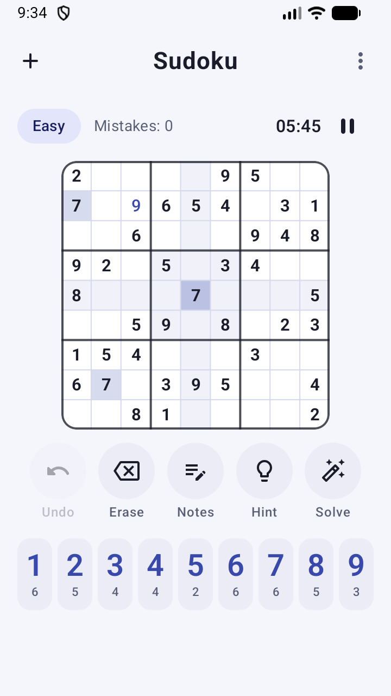
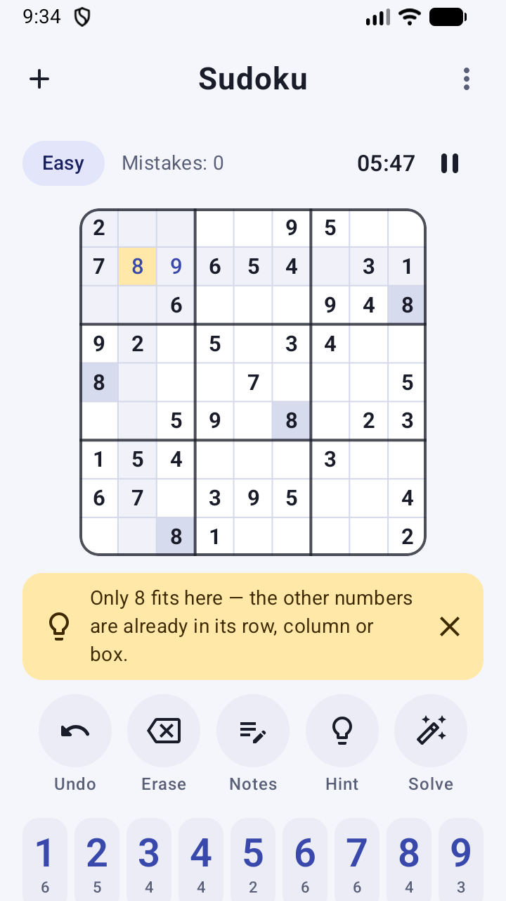
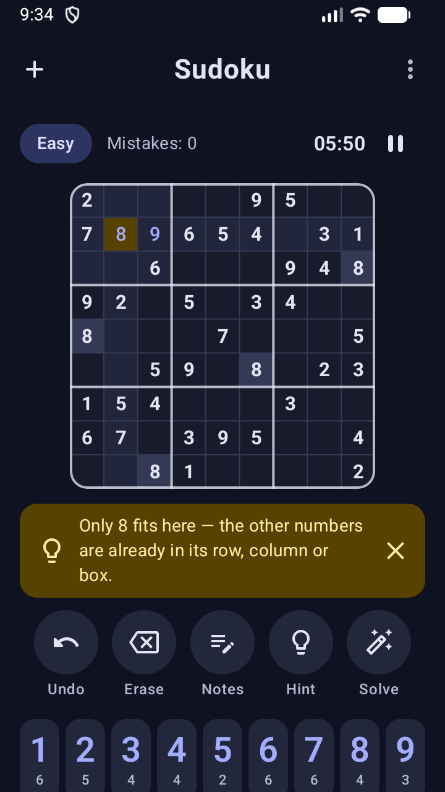
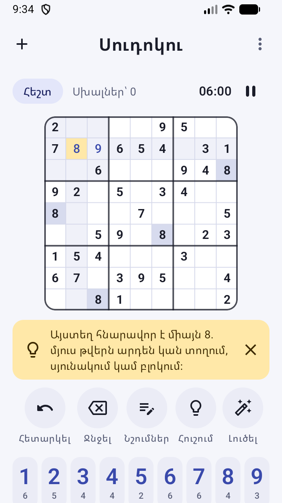

# Sudoku (Android, Kotlin + Jetpack Compose)

A clean, friendly Sudoku game with smart hints, auto-solve, and English, Armenian and Russian translations.

| Playing | Hint | Dark theme | Հայերեն |
|:---:|:---:|:---:|:---:|
|  |  |  |  |

## Download
**[⬇ Download the latest APK](https://github.com/armendeveloper/sudoku-android/releases/latest/download/Sudoku.apk)** (Android 8.0+), or see all [releases](https://github.com/armendeveloper/sudoku-android/releases).

To install, open the file on your phone and allow installs from that source when Android asks. Play Protect may warn that the app isn't from the Play Store. Tap **Install anyway**.

## Features
- Fresh puzzle every game, with a guaranteed unique solution. Four levels: Easy, Medium, Hard, Expert.
- Smart **Hint**: it fixes a mistake first, then looks for a cell where only one number fits, or a number with only one possible spot. It explains why in plain words.
- **Solve** fills in the rest of the board cell by cell, after asking you to confirm.
- Highlights the selected cell's row, column and box, and every copy of the selected number. Mistakes show in red.
- Notes (pencil marks), with "fill all notes" and "clear all notes" in the ⋮ menu. Notes clear themselves from related cells when you place a number.
- Undo, erase, pause (hides the board), a timer, a mistake counter, and how many of each number are left.
- Saves automatically, so you can close the app and continue later.
- English, Armenian (Հայերեն) and Russian (Русский). The app follows the phone's language by default; you can change it under ⋮ → Language (on Android 13+ also in system Settings → Apps → Sudoku → Language).
- Light and dark themes, portrait and landscape. Hardware keyboard works too: 1–9, arrow keys, Backspace, N for notes, H for hint, Z for undo.

## Build
```bash
./gradlew assembleRelease      # APK → app/build/outputs/apk/release/app-release.apk
./gradlew assembleDebug        # APK → app/build/outputs/apk/debug/app-debug.apk
./gradlew testDebugUnitTest    # solver, generator and hint tests
```
Requires JDK 17+ and the Android SDK (compileSdk 37). Opens directly in Android Studio.

The release build is signed with the local debug key so it can be installed for testing. Configure your own signing key before publishing to Google Play.

## Layout
- `engine/` — pure Kotlin: `Solver` (bitmask backtracking), `Generator`, `HintFinder`
- `game/` — `GameViewModel`, immutable `GameState`, `GameStorage` (persistence)
- `ui/` — `Board` (canvas-drawn grid), `Controls`, `Dialogs`, `SudokuScreen`, `Localization` (language picker, localized hint text)
- `res/values`, `values-hy`, `values-ru` — all on-screen text
