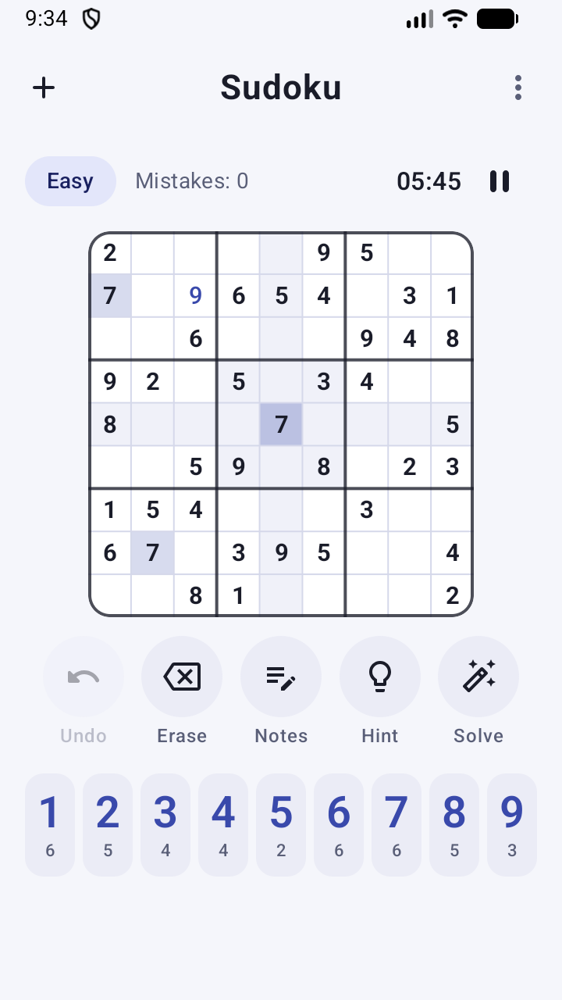
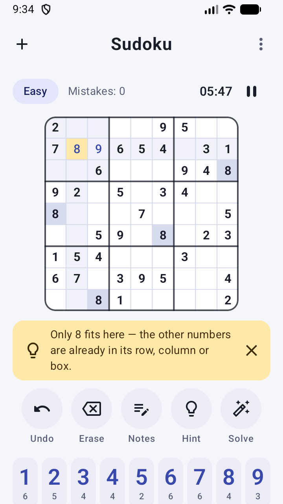
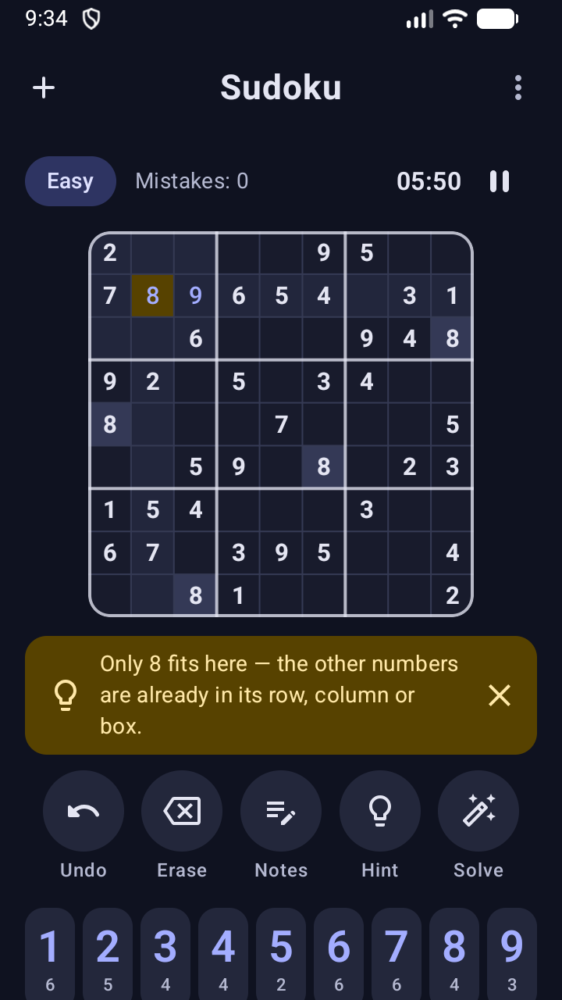
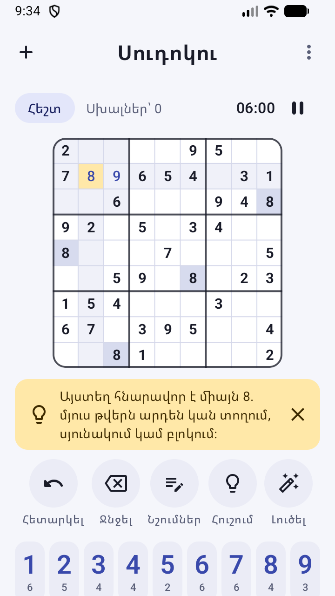

# Sudoku (Android, Kotlin + Jetpack Compose)

A clean, friendly Sudoku game with smart hints, auto-solve, and English, Armenian and Russian translations.

| Playing | Hint | Dark theme | Հայերեն |
|:---:|:---:|:---:|:---:|
|  |  |  |  |

## Download
**[⬇ Download the latest APK](https://github.com/armendeveloper/sudoku-android/releases/latest/download/Sudoku.apk)** (Android 8.0+), or see all [releases](https://github.com/armendeveloper/sudoku-android/releases).

To install, open the file on your phone and allow installs from that source when Android asks. Play Protect may warn that the app isn't from the Play Store. Tap **Install anyway**.

## Features
- Fresh puzzle every game, with a guaranteed unique solution. Four levels, graded by the solving techniques a puzzle actually needs:
  - **Easy** and **Medium**: only singles (Medium has fewer clues).
  - **Hard**: needs pointing, box/line reduction, or naked/hidden pairs.
  - **Expert**: needs triples, X-Wing, XY-Wing or Swordfish.
  
  Every puzzle can be solved by logic alone, with no guessing.
- **Daily challenge**: one puzzle per day, getting harder through the week (Easy on Monday and Tuesday up to Expert on Sunday), with a day streak.
- **Statistics** (chart icon at the top) for each level: games played and won, win rate, best and average time, current and best win streak, and perfect games (no mistakes, no hints). Best times count only games won without hints. The win dialog tells you about a new best time.
- Smart **Hint**: it fixes a mistake first, then finds the simplest next move. When a move needs a technique such as a naked pair or an X-Wing, the hint names it, highlights the cells involved, and explains each step in plain words (tap **Show steps**). It also removes the ruled-out numbers from your notes.
- **Solve** fills in the rest of the board cell by cell, after asking you to confirm.
- Highlights the selected cell's row, column and box, and every copy of the selected number. A short wave plays when you complete a row, column or box, and across the board when you win.
- Notes (pencil marks), with "fill all notes" and "clear all notes" in the ⋮ menu. Notes clear themselves from related cells when you place a number.
- Undo and redo (redo is in the ⋮ menu), erase, pause (hides the board), a timer, a mistake counter, and how many of each number are left.
- **Settings** (⋮ → Settings): light, dark or system theme; language; show mistakes right away or only when you ask for a hint; an optional limit of 3 mistakes; auto-remove notes; highlight options; show or hide the timer; vibration.
- Saves automatically, so you can close the app and continue later.
- English, Armenian (Հայերեն) and Russian (Русский). The app follows the phone's language by default; you can change it under ⋮ → Settings → Language (on Android 13+ also in system Settings → Apps → Sudoku → Language).
- Portrait and landscape. Hardware keyboard works too: 1–9, arrow keys, Backspace, N for notes, H for hint, Z for undo, Y for redo.

## Build
```bash
./gradlew assembleRelease      # APK → app/build/outputs/apk/release/app-release.apk
./gradlew assembleDebug        # APK → app/build/outputs/apk/debug/app-debug.apk
./gradlew testDebugUnitTest    # solver, logic solver, generator, hint, stats and daily tests
```
Requires JDK 17+ and the Android SDK (compileSdk 37). Opens directly in Android Studio.

The release build is signed with the local debug key so it can be installed for testing. Configure your own signing key before publishing to Google Play.

## Layout
- `engine/` — pure Kotlin: `Solver` (bitmask backtracking), `LogicSolver` (human-style techniques, used for grading and hints), `Generator`, `HintFinder`
- `game/` — `GameViewModel`, immutable `GameState`, `GameStorage` (persistence), `Settings`, `Stats`, `Daily`
- `ui/` — `Board` (canvas-drawn grid), `Controls`, `Dialogs`, `Screens` (Statistics and Settings), `SudokuScreen`, `Localization` (language picker, localized hint text)
- `res/values`, `values-hy`, `values-ru` — all on-screen text
